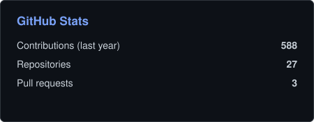
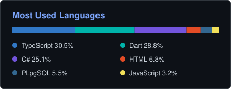

[English](https://github.com/HopeCs/HopeCs/blob/main/README.md) | **Türkçe**

## 💫 Hakkımda

Merhaba, ben Eray 👋 17 yaşındayım. Bursa'da Mehmet Kemal Coşkunöz MTAL Bilişim bölümünde 12. sınıf öğrencisiyim ve aktif olarak [Bursa Web Yazılım](https://bursawebyazilim.com/)'da stajyerim.

## 🧭 Hikâyem

Kodlamaya ortaokulda başladım, lisede bilişim bölümünü seçtim. Liseden önceki yaz Udemy'den Python ve web geliştirme (HTML, CSS, JavaScript) kursları aldım. Lisede sadece okulda anlatılanlarla pek yol alınamayacağını fark edince TÜBİTAK ve TEKNOFEST başta olmak üzere gördüğüm her projeye atladım.

## 🇺🇳 MUN

İngilizce öğretmenimiz bizi Model Birleşmiş Milletler'e katılmaya teşvik etti. Delege olarak başladım, deneyim kazandıkça IT ekiplerinde ve **Head of IT** olarak görev aldım.

## 🚀 Confexon

Bir arkadaşımla konferanslarda işleri kolaylaştıran **[Confexon](https://confexonapp.com)** uygulamasını geliştiriyoruz: başvuru, yönetim ve katılım tek yerde. Ayrıca MUN ile ilgili birçok web sitesi yaptım.

## 🎯 Kod Dışında

Bir şeyler üretmek en büyük hobim. Onun dışında oyun oynamayı, dizi, film ve anime izlemeyi, sinemaya gitmeyi ve calisthenics yapmayı seviyorum.

## 📫 İletişim

## 🌐 Web Siteleri

### Konferans ve Etkinlikler
- [COSMUN 2026](https://cosmun.vercel.app)
- [YönderMUN](https://yondermun.vercel.app)
- [CRAMUN 2026](https://cramun.vercel.app)
- [ARENA MUN 2026](https://arena-mun-2026.vercel.app)
- [NÇALMUN'26](https://ncalmun.vercel.app)
- [Model Senate Bursa 2026](https://modelsenate.vercel.app)
- [Turkuaz Gençlik Çalıştayı](https://genclik-calistayi.vercel.app)
- [Coşkunöz Afet Bilinçlendirme Çalıştayı](https://cosabc.vercel.app)
- [Genç MEB AKUB](https://mebakub.vercel.app)
- [VentureStudio26](https://venturestudio26.vercel.app)

### İşletmeler
- [Ademore Hair Atelier](https://ademore.vercel.app)
- [Ahmet Arslan Hair Studio](https://ahmetarslan.vercel.app)

## 💻 Teknolojiler

### Diller

### Framework ve Kütüphaneler

### Araçlar ve Servisler

## 📊 GitHub İstatistikleri

